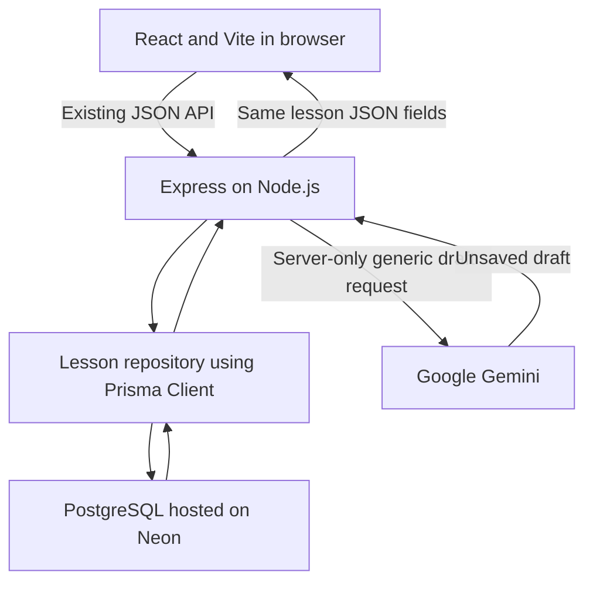

# Phase 9A — Prisma, PostgreSQL and Neon architecture plan

Date: October 15, 2026. Status: proposal only; Phase 9B requires approval.

## Recommendation

Keep React/Vite, Express and Gemini. Replace only the backend persistence layer with Prisma and PostgreSQL on Neon. Begin with one Lesson model representing the existing nine-column lessons table. Keep the original SQLite file and a verified backup as recovery assets. Do not maintain an automatically selected second database backend.

Prisma is the code layer that turns operations such as “create a lesson” into database queries. PostgreSQL stores the records. Neon hosts PostgreSQL; it does not host this React/Express application as part of this proposal.

## Inspected baseline and reusable pieces

Initial branch main, clean working tree, HEAD d796259e1f306905a1620c51b44b2df5145a3e32. Installed Node v24.19.0, Express 5.3.0, React 19.3.0, Vite 8.3.4 and better-sqlite3 13.0.3. No Prisma installed.

Current data path: React → Vite /api proxy → Express → better-sqlite3 → external local SQLite file. server/config.js selects DATABASE_PATH or the user-local AppData/Local/CoachLab/coachlab.sqlite default and rejects relative/normal OneDrive paths. server/index.js opens SQLite, applies the versioned SQL migration, then starts Express on loopback port 3001.

The create route validates fields, inserts with bound parameters, and returns a full row with HTTP 201. Read returns an array ordered by created_at descending, then id descending. AI generation is already implemented: Express contacts Gemini, validates structured drafts and duration, and returns an unsaved draft. Browser editing and approval then use the normal lesson-create route. Approved content is stored as existing text fields, not separate AI tables.

Reusable without application changes if the response contract is retained:

- Entire React frontend: App, LessonForm, AiLessonForm, LessonCard, main, CSS, HTML and Vite configuration.
- server/validate-lesson.js and shared client/src/lesson-draft.js validation/formatting.
- server/ai-provider.js and server/ai-route.js; Gemini remains server-only and receives generic class information, not database credentials or stored records.
- API paths and externally visible behavior: GET /api/health, GET /api/lessons, POST /api/lessons and POST /api/ai/lesson-draft. Preserve health's current liveness semantics; successful lesson reads test database readiness.
- Existing SQLite migration files, retained unchanged as historical/recovery material.

Changes required later: app persistence calls become async; startup and shutdown manage one Prisma client; repository/serialization modules replace prepared-statement access; configuration separates runtime and migration credentials. Tests currently construct SQLite connections directly, so their fixtures must change even when their assertions remain reusable. No endpoint rename or dashboard redesign is needed.

## Target data flow

The browser never imports Prisma or receives either credential. The lesson repository is a small module that owns create/list queries. A serializer converts database values into the existing API shape, including UTC date strings and numeric IDs. SQL execution moves to Prisma; API validation remains in Express.

## Compatibility findings, with verification limits

| Component | Verified evidence | Proposed decision |
| --- | --- | --- |
| Node 24.19.0 | Actual local runtime. Prisma 7 supports Node 24; published 7.10.0 engine metadata accepts >=24.0. | Keep Node 24.19.0. |
| Express 5.3.0 | Actual installed package declares Node >=18. Prisma is a database client, not an Express plugin. | Keep Express; use awaited queries and existing safe error middleware. This integration has not yet been executed. |
| Prisma | Public npm registry inspected for prisma, @prisma/client and @prisma/adapter-pg. Highest non-prerelease version for all three: 7.10.0. prisma's latest tag points to 8.0.0-rc.22, while client/adapter latest is 7.10.0. | Pin all three to 7.10.0 after approval. Recheck on implementation day; do not blindly install latest or mix major versions. |
| PostgreSQL/Neon | Official Prisma PostgreSQL driver documentation and Neon integration guide support this stack. | Use a supported stable PostgreSQL major offered by Neon, matching local/test environments. Confirm exact major in 9B before provisioning. No database connectivity test performed in 9A. |
| JavaScript/ESM | CoachLab already uses type: module. Prisma's modern client generator emits TypeScript; config supports .js. | Keep authored application JavaScript. Use prisma.config.js and an isolated generated-client compilation step, described below. |

Sources: [Prisma 7 system requirements](https://www.prisma.io/docs/orm/v7/reference/system-requirements), [release status](https://www.prisma.io/docs/orm/release-status), [Express 5 reference](https://expressjs.com/en/5x/api/), [public Prisma package metadata](https://registry.npmjs.org/prisma), [client metadata](https://registry.npmjs.org/@prisma%2fclient), [adapter metadata](https://registry.npmjs.org/@prisma%2fadapter-pg). Published requirements establish compatibility expectations, not a substitute for an installation/runtime test.

## Proposed Prisma layout and configuration

All paths below are proposed relative to CoachLab; none have been created.

| Path | Purpose |
| --- | --- |
| prisma/schema.prisma | PostgreSQL datasource, client generator, single Lesson model |
| prisma/migrations/ | Reviewed PostgreSQL migration SQL and Prisma migration lock file |
| prisma.config.js | CLI schema/migration paths and direct connection configuration; no literal secrets |
| server/generated/prisma/ | Ignored generated TypeScript client |
| server/generated-runtime/ | Ignored compiled ESM JavaScript client |
| tsconfig.prisma.json | Narrow compiler configuration for generated client only |
| server/prisma.js | One shared PrismaClient with PostgreSQL adapter and bounded pool |
| server/lesson-repository.js | Async list/create operations and explicit row serialization |
| scripts/import-sqlite.js | Explicit, guarded, resumable data transfer; separate from app startup |
| server/postgres.test.js | Isolated PostgreSQL integration coverage |

Recommend modern prisma-client generator, explicit output and ESM module format. Generate TypeScript then compile only that generated tree to ESM JavaScript using TypeScript; keep the authored React/Express source in JavaScript. Pin a supported compiler version after a small 9B compatibility spike, verify generated imports resolve in Node 24, and add an explicit generate/build step. This avoids silently assuming generated TypeScript is executable by the current scripts. The older prisma-client-js generator still exists in v7 but is deprecated, so it is not the long-term recommendation. No need for an application-wide TypeScript rewrite. [Generator reference](https://www.prisma.io/docs/orm/v7/prisma-schema/overview/generators)

Use datasource provider postgresql in schema.prisma; place the CLI connection in prisma.config.js. Use server-only DATABASE_URL for runtime, DATABASE_URL_UNPOOLED for migrations, and a separate SHADOW_DATABASE_URL where needed. Explicitly load the selected environment with Node's env-file support or a guarded wrapper before invoking the pinned local CLI; Prisma 7 does not make implicit application .env loading a safe assumption. No secret belongs in a schema or generated client. [Config reference](https://www.prisma.io/docs/orm/v7/reference/prisma-config-reference)

For this long-running Express server, recommend @prisma/adapter-pg with pg, one PrismaClient per process, and a small explicit pool (initial proposal: max 5, bounded connection/idle/query timeouts). Reuse the client across requests and disconnect on shutdown, not after each response. An HTTP/WebSocket Neon serverless adapter is an alternative for a future edge/serverless deployment, not an extra dependency needed now. Validate timeout and TLS options against the exact driver version during the spike. [PostgreSQL connector](https://www.prisma.io/docs/orm/v7/core-concepts/supported-databases/postgresql), [pool configuration](https://www.prisma.io/docs/orm/v7/prisma-client/setup-and-configuration/databases-connections/connection-pool)

## Minimal Lesson mapping

Use model Lesson with @@map("lessons"). Keep snake_case property names initially so the JSON contract stays obvious. No future models or fields are necessary.

| Existing column | Proposed Prisma / PostgreSQL | Preservation rule |
| --- | --- | --- |
| id | Int @id @default(autoincrement()) / integer, subject to preflight | Import original IDs explicitly; inspect range first. |
| title | String / text | Required, preserve exact text; retain nonblank database check. |
| discipline | String / text | Preserve exact six labels; retain check constraint. |
| skill_level | String @default("Beginner") / text | Preserve value; retain three-level check. |
| duration_minutes | Int? / nullable integer | Preserve null versus number; retain positive-if-present check. |
| goal | String @default("") / text | Preserve empty text, Unicode and newlines. |
| drills | String @default("") / text | Preserve manual and formatted AI lesson content exactly. |
| coaching_notes | String @default("") / text | Preserve AI review provenance and all notes exactly. |
| created_at | DateTime @default(now()) @db.Timestamptz(3) | Parse existing UTC ISO timestamps, preserve the instant to milliseconds, serialize with toISOString(). |

Prisma's schema alone does not represent every SQLite CHECK rule. Add the equivalent checks to reviewed PostgreSQL migration SQL, keeping API length/enum validation too. Prefer String plus checks over new enums initially so existing labels, including spaces/hyphens, stay unchanged. Use text rather than shortening existing content with varchar limits. Do not normalize, trim or regenerate imported values through the create HTTP API.

SQLite integer IDs can exceed PostgreSQL's 32-bit Int. Before selecting that schema definitively, inspect every ID and duration range using a read-only source/backup reader capable of safe integers. If IDs exceed Int, stop for the explicit BigInt/JSON compatibility decision rather than renumbering or silently losing precision. If any ID exceeds JavaScript's safe integer range, the current numeric API cannot preserve it exactly without a separately approved contract change. This phase did not inspect real rows, so ranges/counts are unknown. Invalid/noncanonical date strings must be reported and resolved before import; no replacement with today's date. Keep original timestamp strings in the protected migration archive for exact historical evidence.

Future users/coaches, athletes, organizations, groups, programs, sessions, progress and separate drafts can later relate to lessons with reviewed foreign keys. Do not invent owners or convert existing lesson content to structured JSON in this migration. Multi-tenant ownership and authentication need their own approved design.

## Environments and Neon setup plan

After approval, create a free development Neon project in a suitable region. Create a distinct test project or explicitly isolated disposable database with its own credentials; reserve a separate project for eventual production. Prefer projects/roles with genuinely separate access over relying on a variable named NODE_ENV. Do not clone real athlete/production data into test branches. A branch made from production can inherit its data and must not be treated as empty.

Use Neon's pooled endpoint for runtime and its direct endpoint for migrations/import administration. Keep TLS enabled and verify server certificates; never use rejectUnauthorized:false or disable Node TLS validation. Do not print URLs in errors, logs, screenshots or CLI diagnostics. Review the pinned pg driver's URL/TLS option interaction before setup. No Prisma Accelerate or second paid pooling service is required. [Neon Prisma integration](https://neon.com/docs/guides/prisma)

| Environment | Database and access | Safeguard |
| --- | --- | --- |
| Local development | Local app with dedicated Neon development database; local PostgreSQL is an optional offline alternative using the same schema/driver | Explicit selected configuration; no production secret on developer terminals |
| Automated tests | Disposable local PostgreSQL database or dedicated Neon test project | TEST_DATABASE_URL only; refuse missing target, unexpected host/database/role, or a target matching development/production; test role has no production access |
| Future production | Separate Neon project and runtime role | Deployment-only secret store, restricted runtime DML grants, separate migration role, explicit deployment approval |
| Migration shadow | Dedicated empty disposable database | Must differ from all real databases; tooling may reset it |

Application startup must fail closed if its configured target is absent/invalid; never fall back to SQLite or another URL. Preserve SQLite as an explicit recovery path using the known-good Git version, not a maintained automatic local fallback. PostgreSQL tests are essential: running only SQLite tests would miss PostgreSQL behavior. Environment guards supplement, rather than replace, least-privilege database credentials. .env files remain ignored; deployment secrets do not go into local Vite variables.

Neon's current Free page lists $0, 100 projects, 100 CU-hours/month/project and 1 GB storage/project, with scale-to-zero and a limited recovery window. These are dated public terms, not verified account entitlements or unlimited capacity. Recheck dashboard limits before provisioning; do not enable upgrades or paid autoscaling without approval. Keep independent backups instead of relying on free-tier restore history. [Neon pricing, checked October 15, 2026](https://neon.com/pricing)

## Schema migration workflow (future commands, not executed)

1. Install exact matching approved Prisma packages and driver/compiler dependencies only in 9B. Generate the client and verify the ESM bridge before touching valuable data.
2. Build the initial PostgreSQL migration on an empty disposable development database with a separate shadow database. Use the pinned local CLI's migrate dev --create-only, review SQL (including checks), then apply it in development. Commit schema and SQL together.
3. Run generate explicitly; Prisma 7 migrate dev does not automatically generate the client. Keep generated/build outputs ignored and reproducible.
4. Apply committed migrations to isolated tests and later approved targets using migrate deploy. It does not need a shadow database and does not generate the client; it also does not replace independent drift verification.
5. Remove automatic SQLite migration execution from the eventual PostgreSQL app startup. Schema changes run as explicit administrative steps. Do not use db push or migrate reset on an imported/valuable database.

Keep server/migrations/001_create_lessons.sql and SQLite schema_migrations history intact. Start independent PostgreSQL Prisma migration history; do not copy SQLite migration bookkeeping into _prisma_migrations. A fresh target needs an initial migration, not a baseline falsely claiming preexisting PostgreSQL tables. [CLI workflow](https://www.prisma.io/docs/orm/v7/reference/prisma-cli-reference), [shadow database](https://www.prisma.io/docs/orm/v7/prisma-migrate/understanding-prisma-migrate/shadow-database), [deploy behavior](https://docs.prisma.io/docs/cli/v7/migrate/deploy)

## Data transfer and rollback runbook

1. Identify the actual configured SQLite file without printing secrets. Inventory schema version, row count, ID/date ranges and data anomalies read-only. Do not assume the default file is the active database.
2. Rehearse with a consistent backup first. During final cutover, stop lesson writes and any process holding the source. Create a verified SQLite backup outside OneDrive using SQLite's backup mechanism; if copying a closed database, account for WAL/sidecars rather than copying a live main file alone. Hash the backup, run integrity_check on the backup and confirm counts. Keep the original untouched and never delete it.
3. Record source identity/hash, schema version, counts and canonical per-row hashes in a protected manifest outside Git. Exports contain lesson data; do not commit them or print their content. The original timestamp strings remain recoverable.
4. Apply reviewed PostgreSQL migrations to an empty confirmed target. Verify endpoint/database/role against the approved destination before any write. Require a dry-run comparison report before import.
5. Import exact values and IDs using bound operations in a transaction for the initial small dataset. Do not route through normal HTTP validation, which trims input and regenerates IDs/dates. For larger datasets, use bounded batches with a persisted manifest and explicit resume semantics.
6. Prevent duplicates by original primary key: a repeat run may skip only records proven identical across every field under the same source manifest. If an existing ID has different data, abort rather than overwrite, ignore conflicts or create another ID. Require empty target on first run; do not merge unrelated data.
7. Reset the PostgreSQL identity/sequence above the imported maximum, handling an empty or nonpositive-ID dataset correctly. Verify a new test insertion cannot collide. This should be tested on the rehearsal database before final cutover.
8. Compare total count, complete ID sets and every field (not a sample). Compare text exactly, null distinctly from empty, and timestamps as equivalent UTC millisecond instants. Check constraints, imported content hashes, GET ordering and response shape. Stop on any mismatch.
9. With writes still frozen, switch the explicitly selected backend configuration and smoke-test reads. Verify the snapshot still matches the frozen source. Enable new writes only after approval of the reconciliation and cutover report.
10. Rollback before new PostgreSQL writes: stop the new app, restore the known-good SQLite code/config from preserved Git history without rewriting history, and point explicitly at the preserved original. Keep the cloud target for investigation.
11. Rollback after new PostgreSQL writes: freeze writes again and export/reconcile all post-cutover records first. Blindly reverting to the old SQLite snapshot would lose new lessons. Back up both sides, reconcile IDs/content without overwriting conflicts, verify counts and fields, and obtain approval before reopening SQLite. Never run both databases as active writers.

A backup is not proven useful until restoration is rehearsed on a separate disposable copy. No backup, import, cutover or restore was performed in Phase 9A.

## Verification plan for Phase 9B

| Area | Required evidence |
| --- | --- |
| Client/connectivity | Pinned client generates/compiles; startup reaches isolated PostgreSQL; pool is reused and closes cleanly; cold-start and timeout behavior are bounded |
| Migrations | Fresh database gains nine-column lesson table plus Prisma metadata; committed migration rerun preserves rows; checks reject invalid raw inserts |
| API compatibility | Same paths/statuses/snake_case fields; numeric id and UTC created_at string; nullable duration; newest-first tie ordering; safe generic errors |
| Create/Read | Manual and approved AI test lessons save/read with exact text and returned IDs; duplicate clicks and failures retain existing UI behavior |
| Persistence | Refresh and full server restart retain records on the same test target |
| Validation/failures | Existing invalid inputs still fail; missing URL, wrong password, network loss, quota/cold start and query timeout produce safe errors without leaking URLs or keys |
| Import accuracy | Empty/single/multiple rows, Unicode, quotes, newlines, SQL-looking strings, null duration, maximum IDs, equal timestamps, rerun, collision and mid-import failure fixtures |
| Migration safety | Backups restore; failed transactions leave no partial import; wrong-target/shadow guards refuse before writes; sequence safely creates new IDs |
| Regression | Port reusable API assertions to PostgreSQL fixtures, keep pure validation and mocked Gemini tests, run frontend build and real browser create/read/approval flows |
| Security | Exact staged files/contents scanned; no URLs/keys/data dumps/database files; browser bundle contains no Prisma/provider secrets; no destructive test credentials can reach production |

No live Gemini call is needed to change storage; existing AI mocks test the save boundary. Do not interpret prior Phase 8A 30/30 results as current Prisma verification. This phase ran the source/walkthrough verifier successfully (25 files, 943 lines); application/database tests were intentionally not rerun because they create and migrate test databases and this request prohibits migrations.

## Complexity, sequence and approval boundary

Estimated effort: medium, roughly 3–5 focused development days including beginner documentation and migration rehearsal; this is an estimate, not a promise. The nine-column model is small. Most risk lies in runtime packaging, credential isolation, import fidelity, constraints, dates/IDs and rollback after new writes.

Recommended approval sequence:

1. 9B compatibility/setup slice: pin stable packages, verify generated-client runtime, provision only approved free development/test databases, add environment safeguards and the single model/migration. Verify and commit code with walkthrough/log.
2. Persistence slice: introduce repository and serializer; convert Express internals to await Prisma while preserving the public routes. Adapt isolated tests; verify manual/AI saves and failures; commit with documentation.
3. Rehearsal slice: backup/import verifier, full fixture and restoration tests, dry-run report for actual data. No real cutover yet.
4. Explicit cutover approval: freeze writes, verified backup, exact import/reconciliation, deliberate configuration switch and monitored acceptance checks. Keep rollback assets.

No application changes, dependency installation, Neon creation, database reads/writes, schema generation, migrations or future models were performed in 9A. Documentation only is committed locally; no push is planned under this request. Approval of a later phase should state whether it includes account provisioning and real-data cutover. Stop here for Phase 9B approval.
